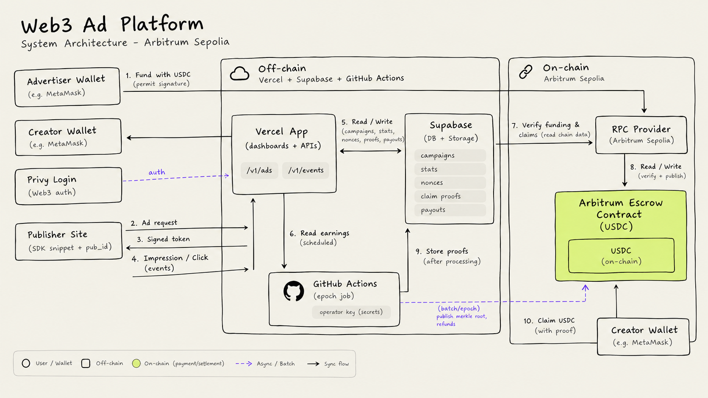

<p align="center">
  
</p>

<h1 align="center">SpringBox</h1>

<p align="center">
  Ads that work for you, on-chain. Advertisers fund campaigns with USDC in escrow, creators earn per verified view.
</p>

<p align="center">
  <a href="https://springbox.dev">Live app</a> ·
  <a href="https://youtu.be/PAutEY7t38Y">Demo</a
</p>

## What it does

- **Advertisers** create a campaign and fund it with USDC held in an on-chain escrow. Unspent budget is refunded when the campaign ends.
- **Publishers and creators** paste a one-line SDK snippet to serve ads and earn per verified view.
- **Settlement:** a daily job publishes earnings as a Merkle root. Creators claim USDC straight to their wallet.
- **Login:** Privy creates a wallet from email or external wallet can be connected for login.

Testnet only. All ETH and USDC come from the built-in faucet and have no real value.

## Architecture



| Part | Role |
|---|---|
| Publisher site + SDK | Requests ads, reports impressions and clicks |
| Vercel app (`frontend`) | Dashboards, `/v1/ads`, `/v1/events`, campaign, claim and faucet routes |
| Supabase | Campaigns, stats, nonces, claim proofs, payouts |
| Arbitrum escrow (`contracts`) | Holds USDC, verifies Merkle claims, handles refunds |
| GitHub Actions (`backend`) | Daily epoch job: publish root, store proofs, refund ended campaigns |

## How a view becomes a payout

1. The SDK asks `/v1/ads/request` and receives an ad plus a signed, single-use token.
2. The SDK sends an impression with dwell-time data to `/v1/events`.
3. The server verifies the token, marks it used, and credits the publisher.
4. The epoch job builds a Merkle tree of cumulative earnings and publishes the root on-chain.
5. The creator claims with a proof from `/v1/claims/me`.

## Repository layout

```
packages/
  frontend/    Next.js app and API routes (Vercel)
  backend/     Epoch job (GitHub Actions)
  contracts/   Foundry escrow and mock USDC
  sdk/         Embeddable publisher script
docs/          Logo and architecture diagram
```

## Embed the SDK

Login as a creator copy your publisher snippet customize and paste in your site to start earning

```html
<script src="https://cdn.springbox.dev/web3ads.min.js"
        data-publisher-id="pub_xxx"
        data-api-url="https://springbox.dev" async></script>
```
## Demo

This site embeds the sdk snippet. Visit to see live.

[read.springbox.dev](https://read.springbox.dev)

## Quick start

```bash
git clone https://github.com/mujtabasaqib/springbox.git && cd springbox
cd packages/frontend && npm install && cp .env.example .env.local && npm run dev
```

See each package's README for its own setup and environment variables.

## Tech stack

Arbitrum Sepolia, Foundry, Privy, Next.js, Tailwind, shadcn, Supabase, viem, Node and TypeScript.

## Licenses

| Package | License |
|---|---|
| `packages/sdk` | MIT |
| `packages/contracts` | MIT |
| `packages/backend` | MIT |
| `packages/frontend` | AGPL-3.0 |

See the `LICENSE` file inside each package.